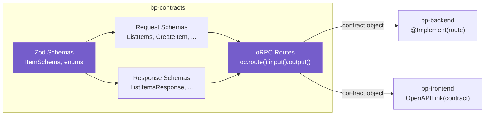
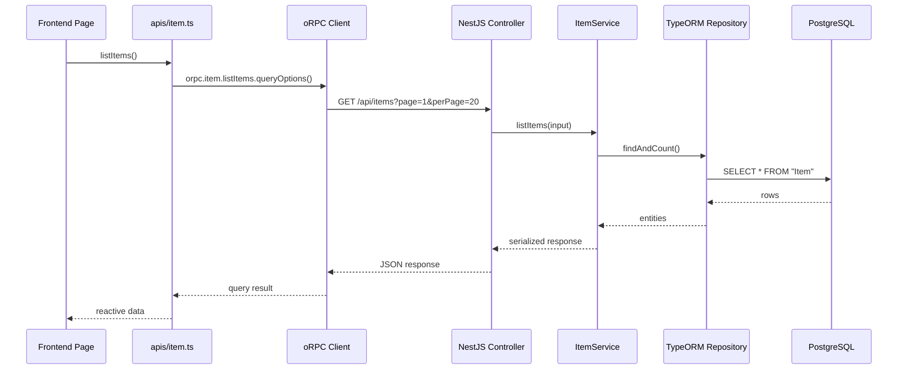
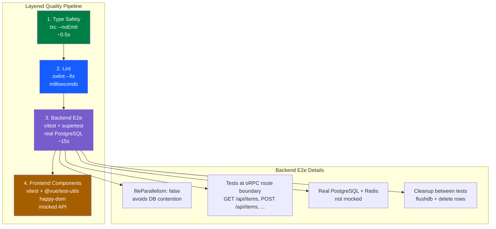

# Architecture

## System Overview

```mermaid
graph TB
    subgraph "sc-boilerplate monorepo"
        Contracts["bp-contracts<br/>oRPC + Zod<br/>Shared API contracts"]
        Backend["bp-backend<br/>NestJS 11 + TypeORM<br/>PostgreSQL + Redis"]
        Frontend["bp-frontend<br/>Vue 3.5 + TSX<br/>Nuxt UI + Pinia Colada"]
    end

    Contracts -->|"dist/esm + dist/types"| Backend
    Contracts -->|"dist/esm + dist/types"| Frontend
    Backend -->|"RESTful routes<br/>(OpenAPILink)" Frontend

    subgraph "Infrastructure"
        PG[("PostgreSQL 17")]
        Redis[("Redis 7")]
    end

    Backend --> PG
    Backend --> Redis
```

## Contract-First Flow



## Data Flow



## Testing Strategy


